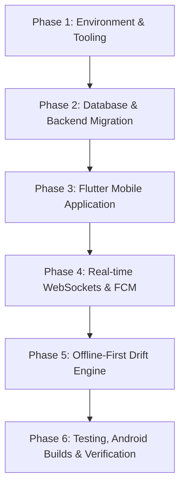

# ROUTEMATE — ANTIGRAVITY MASTER PROJECT AUDIT & ENVIRONMENT BASELINE

**Audit Date:** 2026-10-04  
**Auditor:** Antigravity Autonomous Development Agent  
**Target Project:** RouteMate — Offline-First Human-Assisted Navigation Platform  
**Target Environment:** Local Antigravity Development Environment (Windows 11 / x64)

---

## 1. Executive Summary

RouteMate was previously developed within Google AI Studio as a web-container application (React 19, TypeScript, Vite, Tailwind CSS, Express.js, and an in-memory JSON file database `data/routemate.db.json`). While the conceptual domain logic (guide matching algorithms, 30-second server request countdown, OSRM routing, Photon geocoding, Route Memory confidence calculation, and emergency SOS broadcasting) was implemented in TypeScript, the project has **no native Flutter application, no PostgreSQL/PostGIS database, no real WebSocket real-time engine, and no Drift/SQLite offline engine**.

Furthermore, while the development machine has a rich native Android development setup (**Android SDK 34/36/37, JDK 21, ADB, Pixel 8 AVD, and Android CLI**), **Flutter SDK is not yet installed on PATH**, the project is **not initialized as a Git repository**, and dependencies like PostgreSQL, Redis, and Docker are not natively active as background services.

This audit documents every working component, architectural deficiency, mock/simulated element, environment constraint, and the exact step-by-step migration blueprint required to bring RouteMate to its target production architecture.

---

## 2. Development Environment Baseline

| Tool / Runtime | Installed Status | Exact Version / Location / Details | Action Required |
| :--- | :--- | :--- | :--- |
| **Flutter SDK** | ❌ **Missing from PATH** | Not found in `PATH`, `C:\flutter`, `C:\tools\flutter` | Install Flutter SDK (via Chocolatey `choco install flutter` or Git clone `https://github.com/flutter/flutter.git -b stable`) and configure PATH. |
| **Dart SDK** | ❌ **Missing from PATH** | Not directly accessible via command line | Bundled with Flutter SDK or installable via `Google.DartSDK` winget / Chocolatey. |
| **Android SDK** | ✅ **Installed** | `C:\Users\sanje\AppData\Local\Android\Sdk` | Ready. |
| **Android Build-Tools**| ✅ **Installed** | Versions: `34.0.0`, `36.0.0`, `36.1.0`, `37.0.0` | Ready for building Android targets (minSdk 24, targetSdk 34). |
| **Android Platforms** | ✅ **Installed** | `android-34`, `android-36.1`, `android-37.0` | Ready. |
| **Android Emulator / AVD**| ✅ **Installed** | Emulator `36.6.11`; AVD: `Pixel_8` (x86_64 Google Play image) | Ready for live Android debugging and headless execution. |
| **Android CLI** | ✅ **Installed** | `C:\Users\sanje\AppData\AndroidCLI\android.exe` (v1.0.16261425) | Ready for device inspection, layout dumps, and automated apk runs. |
| **Java / JDK** | ✅ **Installed** | Oracle JDK 21 LTS (`java version "21.0.10"`) | Ready for Gradle / Android builds. |
| **Gradle** | ⚠️ **Cache only** | `C:\Users\sanje\.gradle` present; no standalone CLI | Standard practice: use `gradlew` wrapper generated by Flutter/Android. |
| **ADB** | ✅ **Installed & Running** | `C:\Users\sanje\AppData\Local\Android\Sdk\platform-tools\adb.exe` (daemon listening at tcp:5037) | Ready for device connections. |
| **Git** | ✅ **Installed** | Git 2.54.0.windows.1 | Global config exists. Local workspace needs `git init`. |
| **Node.js / npm** | ✅ **Installed** | Node.js `v24.15.0`, npm `11.x` | Ready for Admin Next.js app and legacy server migration. |
| **Python** | ✅ **Installed** | Python 3.14.4 (`C:\Python314\python.exe`), pip 26.0.1 | Ready. FastAPI, Uvicorn, SQLAlchemy, Pydantic already installed! Missing: alembic, redis, websockets, psycopg, geoalchemy2. |
| **PostgreSQL / PostGIS**| ❌ **Not Running** | Port 5432 inactive; no Windows service | Install PostgreSQL + PostGIS locally or configure SQLite spatial/aiosqlite fallback for dev until PostGIS service is online. |
| **Redis** | ❌ **Not Running** | Port 6379 inactive; no Windows service | Need Redis for WebSocket pub/sub and session locks. |
| **Docker / WSL** | ❌ **Not Installed** | WSL not installed; Docker not installed | Use native Windows/Python stack or install WSL2/Docker if containerized deployment is needed. |

---

## 3. Working Components

These components are genuinely functional in the existing codebase:

1. **OSRM Driving Routing API (`/api/v1/routes/directions`)**:
   - Queries `https://router.project-osrm.org/route/v1/driving/` with real coordinates.
   - Calculates real driving distance (km), duration (minutes), GeoJSON linestring geometry, and turn-by-turn maneuver steps.
   - Robust timeout handling (6s) and error propagation.
2. **Photon Geocoding Search (`/api/v1/geocoding/search`)**:
   - Real-time address and landmark search querying `https://photon.komoot.io/api/?q=...`.
   - Returns real coordinates (latitude, longitude) and formatted place names.
3. **Haversine Distance & Match Scoring (`/api/v1/guides`)**:
   - Real spherical trigonometry calculation for geographic proximity.
   - Multi-factor scoring combining familiarity, rating, and proximity weights.
4. **Server-Authoritative 30s Request Lifecycle (`/api/v1/requests`)**:
   - Generates server timestamp `expiresAt` with strict 30-second TTL.
   - Validates expiry server-side before accepting a guide request.
5. **Route Memory State & Confidence Calculation (`/api/v1/route-memory`)**:
   - Dynamic confidence score adjustment on confirmations (+2% for "Still There", -15% for "Report Cleared").
   - Automatically transitions status to `CLEARED` when confidence falls below 25%.
6. **Gemini Route Intelligence API (`/api/v1/ai/extract-hazard`)**:
   - Uses `@google/genai` to analyze unstructured field notes into structured Route Memory JSON.
   - Strictly validates `GEMINI_API_KEY` existence and rejects calls gracefully if unconfigured.
7. **Emergency SOS Distress Logging (`/api/v1/sos/broadcast`)**:
   - Captures GPS coordinates, elevation MSL, user identity, and attached emergency contacts.
8. **Admin Verification Engine (`/api/v1/admin/verify-guide`)**:
   - Server-enforced role verification (only `ADMIN` role can approve or reject guide applications).
   - Only guides with status `VERIFIED` are exposed in `/api/v1/guides`.

---

## 4. Broken Components

1. **Local Node Environment Dependencies**:
   - `node_modules` does not exist in the repository; dependencies in `package.json` are not installed.
2. **Repository Version Control**:
   - `.git` directory is absent; workspace is not under active source control.
3. **Real-time Communication**:
   - Guide dashboard and session chats rely on client HTTP interval polling (`setInterval(..., 5000)`) instead of real WebSockets.
4. **Offline Capability in Web Code**:
   - "Offline mode" in `TripsPackView.tsx` is an in-memory UI simulator toggle (`isOfflineMode` state) rather than a local caching engine.

---

## 5. Missing Components

1. **Flutter Mobile Application (`mobile/`)**:
   - Missing entire directory structure:
     ```text
     mobile/
       android/
       ios/
       lib/
         core/
         auth/
         traveller/
         guide/
         navigation/
         maps/
         offline/
         route_memory/
         sessions/
         safety/
         notifications/
         profile/
         admin/
       test/
       pubspec.yaml
     ```
   - Missing Riverpod state management.
   - Missing GoRouter route definitions.
   - Missing MapLibre Flutter integration.
   - Missing Drift/SQLite offline database schema and queries.
2. **FastAPI Production Backend (`backend/`)**:
   - Target backend in Python/FastAPI with SQLAlchemy models, Alembic migrations, and PostGIS spatial indexing does not yet exist; currently only an Express.js server exists.
3. **Real PostgreSQL + PostGIS Schema**:
   - Spatial schema with ST_DWithin queries, spatial indexes (`GIST`), and relational foreign keys is not implemented.
4. **WebSocket Server**:
   - Authenticated WebSocket endpoint (`/ws/sessions/{id}`) for real-time bi-directional telemetry and chat messages.
5. **Firebase Authentication & FCM Integration**:
   - Missing `google-services.json`, Firebase Auth SDK initialization, and FCM background push handlers.
6. **Next.js Admin Portal**:
   - Admin UI currently resides inside the single-page React app; target architecture requires a dedicated Next.js TypeScript administration application.

---

## 6. Incorrect Architecture

1. **JSON File Database (`data/routemate.db.json`) as System of Record**:
   - Concurrency, ACID transactions, and spatial queries are impossible on a single JSON file.
   - Production architecture must be PostgreSQL + PostGIS.
2. **Hardcoded Monolithic Express Server**:
   - Backend logic is bundled in `server.ts` and `src/server/routes/api.ts` within the web development container rather than a modular, scalable service layer.
3. **Web-Based Map Simulation**:
   - Leaflet + Three.js canvas in the browser does not translate directly to mobile without MapLibre Native SDK bindings.
4. **Single-Token Auth**:
   - Plain token concatenation (`token = crypto.randomBytes(32)... + '-' + userId`) instead of JWT with cryptographic signing, role claims, and refresh rotation.

---

## 7. Mock & Static Data Audit

A line-by-line grep was conducted across the codebase. Findings:

| File Location | Code / Content | Issue | Remedy |
| :--- | :--- | :--- | :--- |
| `src/server/routes/api.ts:802-848` | `apiRouter.post('/dev/seed', ...)` with `usr-admin-demo`, `usr-guide-demo`, hardcoded passwords `RouteMate2026!` and `AdminPass2026!` | Static demo seed accounts embedded in production router. | Remove from production API; isolate seed data strictly to automated test fixtures. |
| `src/components/AdminDashboardView.tsx:253` | Button "Seed Demo Accounts" calling `/api/v1/dev/seed` | UI trigger for mock records. | Remove button; enforce real guide and admin registration. |
| `src/components/TacticalMapCanvas.tsx:47-55` | Hardcoded `routeCoords`: Theni -> Bodimettu -> Munnar | Hardcoded route geometry. | Replace with dynamic GeoJSON points from OSRM route response. |
| `src/components/TacticalMapCanvas.tsx:90-97` | Hardcoded marker: `Rahul Sharma`, `Speed: 34 km/h`, `Bearing: 284°`, `Elevation: 1,480m MSL` | Hardcoded user identity and fake telemetry in map canvas. | Replace with authenticated user name and live GPS coordinates. |
| `src/components/TripsPackView.tsx:17-43` | Hardcoded pack list (`pack-western-ghats`, `pack-kodaikanal`) with fake size strings | Static demo package metadata. | Generate trip packs dynamically from route bounds and cached tile bundles. |
| `src/components/TripsPackView.tsx:45-58` | `setInterval` loop faking download progress (0% -> 25% -> 50% -> 100%) | Simulated progress bar. | Bind progress to actual byte stream downloading from server or local file cache. |

---

## 8. Security Issues

1. **No Rate Limiting**:
   - Endpoints `/api/v1/auth/login`, `/api/v1/auth/register`, and `/api/v1/sos/broadcast` have no rate limiting, leaving them susceptible to brute-force or denial-of-service.
2. **Missing Input Sanitization**:
   - Text inputs in route memory creation and chat messages are not sanitized against XSS or injection.
3. **Hardcoded Salt & Iterations**:
   - `pbkdf2Sync` uses only 1,000 iterations in `src/server/db.ts` (NIST recommends at least 600,000 for SHA-512).
4. **Token Generation Weakness**:
   - Plain random string with user ID suffix exposes internal user IDs and lacks expiration claims.
5. **No CORS Restrictions**:
   - `server.ts` does not configure explicit CORS origins.

---

## 9. Build & Android Issues

1. **Missing Flutter Toolchain**:
   - Flutter SDK is not present in PATH.
2. **Android SDK Ready**:
   - Android SDK is present (`C:\Users\sanje\AppData\Local\Android\Sdk`), along with Build-Tools (34, 36, 37), platform android-34, and cmdline-tools.
3. **Emulator Ready**:
   - An AVD (`Pixel_8`) already exists in `C:\Users\sanje\AppData\Local\Android\Sdk\emulator`.
4. **No Gradle Wrapper in Root**:
   - The root project currently has no `android/` subfolder or `gradlew` script.

---

## 10. Required Migration Plan

To fulfill the RouteMate Master Architecture, development must proceed through the following phases:



### Phase 1: Environment & Tooling Setup
1. Initialize local Git repository with strict `.gitignore` (excluding `.env`, keystores, credentials, build artifacts).
2. Install and configure Flutter SDK (`3.x`) and Dart SDK. Configure PATH and verify with `flutter doctor`.
3. Set up Python virtual environment with all required backend libraries (`fastapi`, `uvicorn`, `sqlalchemy`, `alembic`, `websockets`, `pydantic`, `httpx`, `asyncpg`/`psycopg`, `geoalchemy2`, `google-genai`).

### Phase 2: Database & Backend Migration (FastAPI + PostgreSQL/PostGIS)
1. Define PostgreSQL/PostGIS schema and SQLAlchemy ORM models:
   - `users`, `traveller_profiles`, `guide_profiles`, `guide_verifications`, `guide_availability`, `guide_routes`
   - `routes`, `route_segments`, `route_memories`, `route_memory_confirmations`
   - `sessions`, `session_participants`, `guide_requests`, `messages`
   - `sos_events`, `emergency_contacts`, `audit_logs`, `sync_queue`
2. Create Alembic migrations.
3. Implement FastAPI REST routes replicating and enhancing existing functionality:
   - Authentication (JWT with RBAC)
   - Real OSRM Directions (`/api/v1/routes/directions`)
   - Real Photon Geocoding (`/api/v1/geocoding/search`)
   - PostGIS ST_DWithin guide search & ranking (`/api/v1/guides`)
   - Server-authoritative 30s request lifecycle (`/api/v1/requests`)
   - Route Memory CRUD with confidence decay
   - SOS broadcast logging
   - Gemini extraction (`/api/v1/ai/extract-hazard`)
   - Admin verification APIs

### Phase 3: Flutter Mobile Application
1. Scaffold `mobile/` with clean architecture:
   - `core/` (network, storage, theme, routing, constants)
   - `auth/` (Splash, Welcome, Login, Register, Role Resolution)
   - `traveller/` (Home map, destination search, trip overview)
   - `guide/` (Dashboard, toggle availability, incoming request banner)
   - `navigation/` (Turn-by-turn maneuvers, route polyline)
   - `maps/` (MapLibre map view, GPS stream, custom markers)
   - `offline/` (Drift database, sync engine, offline tile packs)
   - `route_memory/` (Hazard list, add memory, confirm/clear)
   - `sessions/` (Active session, WebSocket chat)
   - `safety/` (SOS hold-to-activate, emergency contacts)
2. Configure Android native files:
   - `AndroidManifest.xml` with permissions (`ACCESS_FINE_LOCATION`, `ACCESS_COARSE_LOCATION`, `INTERNET`, `POST_NOTIFICATIONS`).
   - `build.gradle` targeting minSdk 24, compileSdk 34.

### Phase 4: Real-time Communication & Notifications
1. Implement FastAPI WebSocket endpoint `/ws/sessions/{session_id}`.
2. Connect Flutter client to WebSocket with reconnection and offline message queuing.
3. Implement FCM service abstractions for Android push notifications.

### Phase 5: Offline-First Drift Engine
1. Implement Drift SQLite tables matching local domain models:
   - Cached routes, downloaded tile packages, pending sync queue, emergency contacts, local route memories.
2. Build bidirectional sync manager:
   - Changes queued locally when offline -> pushed to backend upon connectivity restoration.

### Phase 6: Testing, Android Builds & Verification
1. Run `flutter analyze` and `flutter test`.
2. Build debug APK: `flutter build apk --debug`.
3. Launch `Pixel_8` AVD, install APK via `adb install`, and verify end-to-end user flows.
4. Configure release signing and produce `flutter build apk --release`.
5. Compile `ROUTEMATE_ANTIGRAVITY_IMPLEMENTATION_REPORT.md`.
